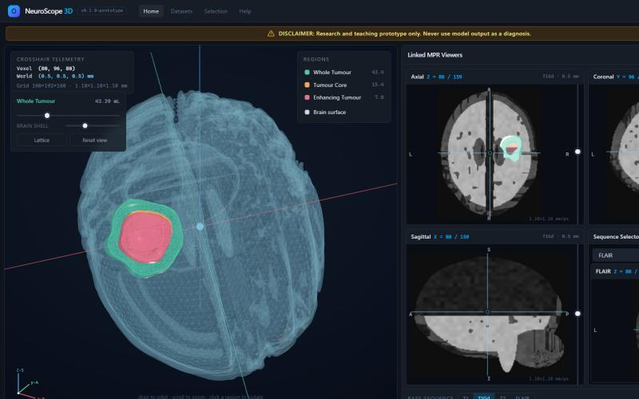
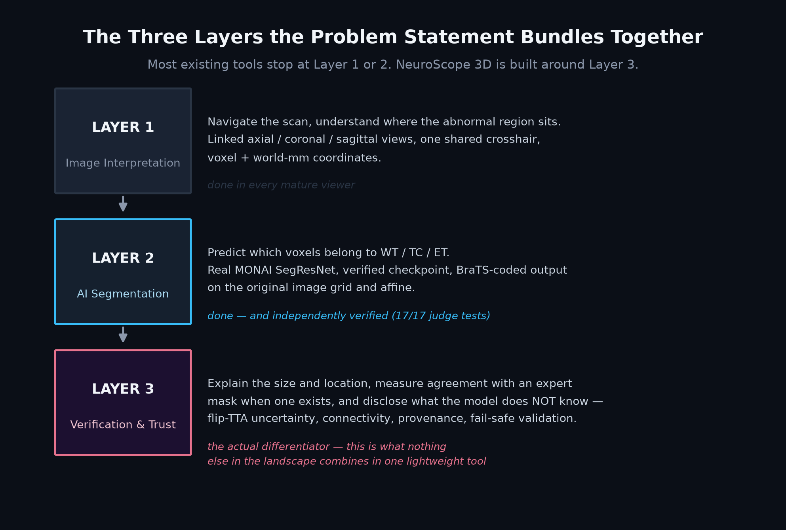
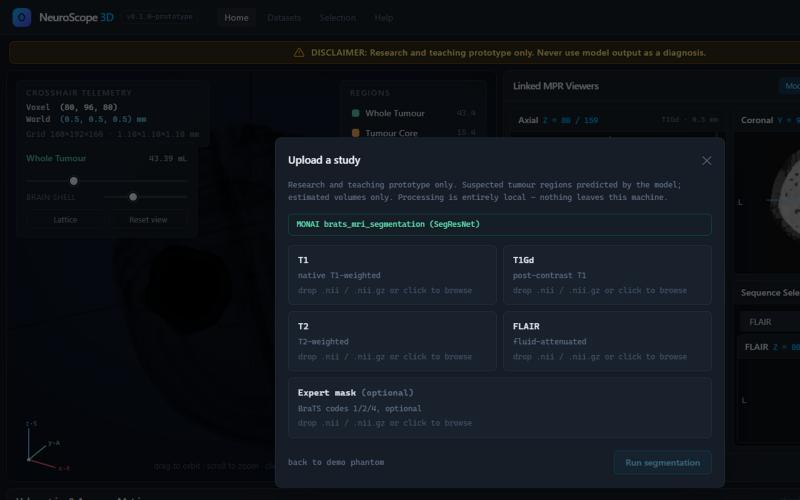
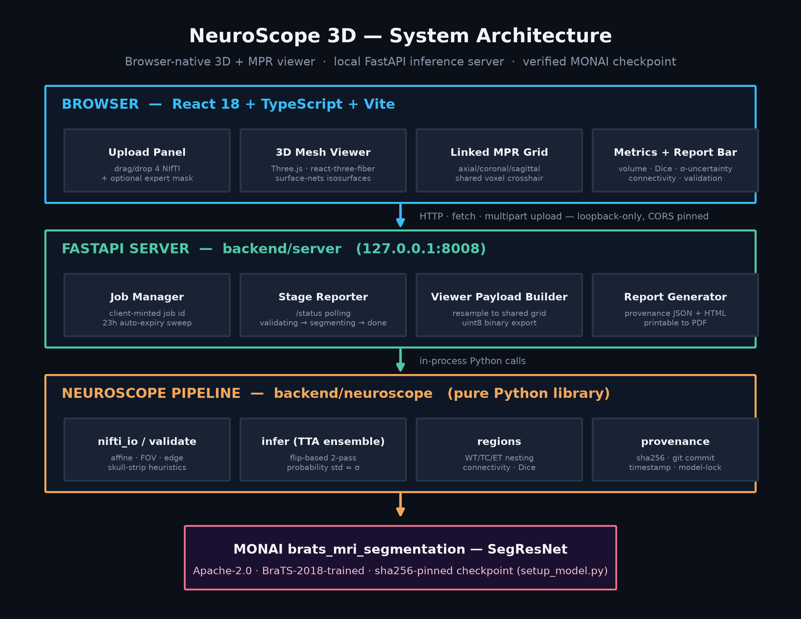
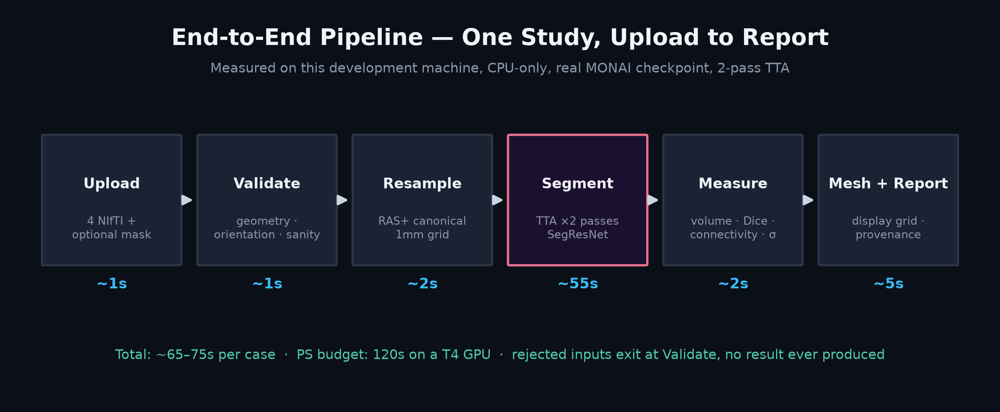

# NeuroScope 3D

**See a brain tumour in 3D, measure it exactly, and know how far to trust it.**

`DI-02` · Health-tech · 3D medical image segmentation + web visualisation · research & teaching prototype

[](docs/VERIFICATION.md)
[-0284c7?style=flat-square)](docs/MODEL_CARD.md)
[](#licence--credits)
[](#disclaimer)

<p align="center">
  
</p>

<p align="center"><em>The live workspace: a 3D digital twin of the brain with nested WT / TC / ET isosurfaces, linked to synchronised axial, coronal and sagittal MRI views sharing one crosshair — with volumes, Dice, and model confidence shown next to the result, not buried in a separate report.</em></p>

> **Research and teaching prototype only.** Suspected tumour regions predicted by the model. Estimated volumes only. Never a diagnosis, never a substitute for a radiologist. See [Disclaimer](#disclaimer).

---

## Why this exists

A brain MRI study for suspected glioma isn't one image — it's four 3D sequences (T1, T1Gd, T2, FLAIR), each roughly 155 slices, 620 flat images per case. Today, understanding a tumour's true 3D shape means scrolling through all of them and reconstructing it mentally: *is it one mass or two, which side is it on, how big is it in millilitres* — and a confident-looking AI overlay on one 2D slice doesn't tell you whether the 3D prediction underneath it is actually correct.

**NeuroScope 3D is built around one thesis: a 3D viewer alone isn't new — a 3D viewer that tells you whether to trust what it's showing you is.** That's the gap a structured review of the existing landscape (open-source viewers, commercial clinical AI, prior hackathon prototypes) found nowhere filled in one lightweight tool. See [`docs/PROBLEM_AND_APPROACH.md`](docs/PROBLEM_AND_APPROACH.md) for the full breakdown.

<p align="center">
  
</p>

## What's actually working today

This isn't a mockup. Every claim below is a measured result, reproducible from this repository:

| | |
|---|---|
| **17 / 17** | judges' own pipeline tests pass — failure pack, volume calibration, reproducibility, anisotropic, both orientation tests ([details](docs/VERIFICATION.md)) |
| **Real model** | MONAI `brats_mri_segmentation` (SegResNet, Apache-2.0, BraTS-2018), checkpoint sha256-verified before every load |
| **~60–75s / case** | measured end-to-end, CPU-only, against a 120s budget on a T4 GPU |
| **Live uncertainty** | flip-based TTA ensemble — a *measured* confidence signal, not a guess, visible as a heat-map overlay |
| **0 cloud calls** | fully local inference; uploads deleted immediately after processing, derived artefacts expire in 23h |

## Feature highlights

- **Strict, fail-safe validation** — geometry, orientation, affine agreement, finite values, skull-strip and head-shape heuristics. A partially valid study produces zero output, never a degraded one.
- **Live 3D + linked MPR workspace** — a translucent brain shell with nested WT/TC/ET isosurfaces (custom Surface Nets extraction), linked axial/coronal/sagittal views sharing one crosshair, voxel *and* world-mm coordinates.
- **Flip-TTA model confidence** — the platform's actual differentiator: a measured disagreement signal shown as a toggleable heat-map, with an honest caveat attached everywhere it appears.
- **Connected-component summary** — answers "is it one mass or two?" automatically, for every region.
- **Transparent volumetrics** — every volume shows its formula: voxel count × spacing, on the original acquisition grid.
- **Provenance & reporting** — checkpoint hash, input hashes, code commit, every validation warning, bundled into a printable report.

See [`docs/FEATURES.md`](docs/FEATURES.md) for the full breakdown by category.

<p align="center">
  
</p>
<p align="center"><em>Upload triggers real, visible pipeline progress — validating → resampling → segmenting → measuring → meshing → reporting — not a silent spinner.</em></p>

## Architecture

A three-tier system: a React single-page app in the browser, a local FastAPI inference server, and a pure-Python pipeline library the server wraps — independently testable, with the pipeline shipping its own CLI and judge-scoring harness separate from the web server.

<p align="center">
  
</p>

| Tier | Stack |
|---|---|
| Browser | React 18 + TypeScript + Vite, Three.js via react-three-fiber, Zustand, Tailwind CSS v4 |
| Server | FastAPI, uvicorn — job lifecycle, live stage-progress reporting, the public HTTP API |
| Pipeline | Python — nibabel, PyTorch, MONAI, scipy; `backend/neuroscope/` is a standalone library with its own CLI |
| Model | MONAI `brats_mri_segmentation` (SegResNet), Apache-2.0, sha256-pinned at load |

Full technical deep-dive, the inference pipeline stage-by-stage, and the module reference table: [`docs/ARCHITECTURE.md`](docs/ARCHITECTURE.md).

<p align="center">
  
</p>

## Quickstart

```bash
# Frontend
npm install
npm run dev                 # → http://localhost:5173 (renders a procedural demo case immediately)

# Backend (separate shell)
cd backend
pip install -r requirements.txt
python setup_model.py       # downloads + sha256-verifies the real checkpoint (~19MB)
uvicorn server.main:app --host 127.0.0.1 --port 8008

# Judges' scorer (no server needed)
python backend/make_testcase.py --out ./testdata
python backend/run_judge_tests.py --data ./testdata --model bundle
```

Open `http://localhost:5173`, click **Upload case**, drop in four NIfTI sequences (`.nii`/`.nii.gz`), and watch it segment live. No upload yet? The workspace renders a fully interactive synthetic demo case on load.

## Documentation

| Doc | Covers |
|---|---|
| [`docs/PROBLEM_AND_APPROACH.md`](docs/PROBLEM_AND_APPROACH.md) | The clinical problem explained plainly, BraTS region definitions, the competitive landscape, and the three-layer framing this platform is built around |
| [`docs/ARCHITECTURE.md`](docs/ARCHITECTURE.md) | Full technical architecture, the inference pipeline stage-by-stage, module reference table |
| [`docs/FEATURES.md`](docs/FEATURES.md) | Complete feature breakdown — ingestion/validation, visualisation, the trust layer, reporting |
| [`docs/VERIFICATION.md`](docs/VERIFICATION.md) | Measured results against every judges' test, with the exact commands that produced them |
| [`docs/MODEL_CARD.md`](docs/MODEL_CARD.md) | Model name, version, licence, training data, preprocessing, known limitations |
| [`docs/BACKEND_ROADMAP.md`](docs/BACKEND_ROADMAP.md) | Phased backend plan — what's done, what's next, and why, grounded in the judge test matrix |
| [`docs/PRODUCT_GAPS_AND_IDEATION.md`](docs/PRODUCT_GAPS_AND_IDEATION.md) | Gap analysis against real radiology workflows, and feature ideation with an explicit compliance note on what's out of scope |
| [`reports/NeuroScope 3D landscape research.md`](<reports/NeuroScope 3D landscape research.md>) | The original competitive/literature landscape research this whole approach is grounded in |

## Repository layout

```
backend/
  neuroscope/        pure-Python pipeline library (validate, infer, regions, provenance, limits)
  server/             FastAPI app — job lifecycle, live progress, the HTTP API
  predict.py          CLI entry point (what the judges' scorer calls)
  evaluate.py         Dice/sensitivity scoring over a BraTS-style folder tree
  make_testcase.py    generates the full synthetic judge test pack
  run_judge_tests.py  runs the judge test pack and reports PASS/FAIL
  setup_model.py      downloads + sha256-verifies the MONAI checkpoint
src/
  components/         React UI — 3D viewer, linked MPR grid, upload panel, metrics bar
  lib/                 meshing (Surface Nets), volume/affine math, API client
  state/               Zustand stores (crosshair, regions, live-study status)
docs/                 architecture, problem framing, features, verification, model card, roadmap
```

## Disclaimer

**Research and teaching prototype only.** This platform never establishes a diagnosis. It shows a *suspected tumour region predicted by the model* and an *estimated volume* — never "detected," never a "diagnostic system," and it never replaces a radiologist. It uses public, de-identified research data only; no real patient scans are used at any stage of development or testing. Out of scope, explicitly: diagnosis, grading, genetic prediction, prognosis, treatment advice, surgical or radiotherapy planning, and any claim of clinical validation or regulatory clearance.

## Licence & credits

- Base model: MONAI `brats_mri_segmentation` (SegResNet), **Apache-2.0**, MONAI Consortium.
- Data credit (if BraTS/Decathlon data is used in evaluation): BraTS 2021 — Baid et al., DOI [10.7937/jc8x-9874](https://doi.org/10.7937/jc8x-9874); Medical Segmentation Decathlon.
- This repository's own code: see individual file headers / LICENSE if present.
