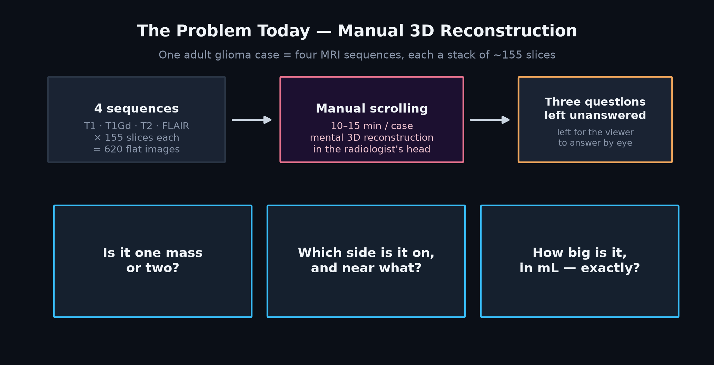
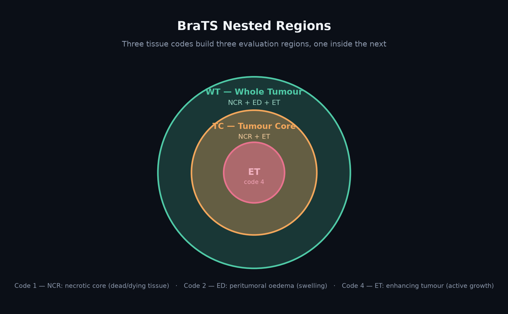

# The Problem and Our Approach

This document explains, without assuming prior clinical knowledge, what problem NeuroScope 3D solves, why it's still open despite years of segmentation research, and the three-layer framing that shapes every design decision in this repository.

## The problem, in plain terms

Picture a brain MRI as a loaf of bread, sliced into roughly 155 cross-sections. A radiology team doesn't get one loaf — they get **four**, each sliced the same way but acquired under a different contrast setting, because different tissue types only reveal themselves under specific MRI sequences:

| Sequence | What it reveals |
|---|---|
| **T1** (native) | Baseline anatomy and structural boundaries |
| **T1Gd** (post-contrast) | Active, growing tumour cells — they absorb the contrast agent |
| **T2**-weighted | Structural context around the lesion |
| **FLAIR** | Swelling and fluid build-up around the tumour (oedema) |

  

A trainee has to hold all four of these — **620 flat images** — in their head at once, scrolling back and forth, to answer three questions that sound simple but aren't:

1. **Is it one connected mass or several?**
2. **Which side of the brain is it on, and what is it near?**
3. **What is its exact volume in millilitres?**

The third question matters well beyond a single viewing — tracking whether a tumour is 12 mL or 18 mL across successive scans is how growth or shrinkage under treatment gets measured, and humans are reliably bad at estimating irregular 3D volume from 2D slices by eye.

### Why an AI overlay alone doesn't solve this

Segmentation models that colour in the suspected tumour on a 2D slice have existed for years — the [BraTS challenge](https://www.med.upenn.edu/cbica/brats/) has run annually since 2012. The output of one of those models is still, by itself, only a **2D cross-section of a 3D guess**. Looking at a coloured patch on one slice doesn't tell a viewer how far it extends through the other 154 slices, whether it connects to another coloured region elsewhere in the volume, or — the point that matters most — **whether the model's boundary is actually right**. A plausible-looking mask is not evidence of an accurate one.

This is not for lack of trying. BraTS accuracy has improved steadily for over a decade — the bottleneck was never whether a model could find a tumour. Accuracy research and product research have largely stayed separate: academic work optimises Dice scores on a static benchmark, while the handful of products that reach real users optimise for regulatory clearance and clinical workflow fit. Neither side has had strong incentive to build the lightweight, transparent, trust-first interface layer that connects the two.

## BraTS region definitions

To make "tumour volume" a well-defined, comparable number, the field doesn't segment "the tumour" as one blob. The BraTS benchmark — the standard this platform is built against — defines three tissue codes that combine into three **nested** evaluation regions:

  

| Region | Built from | Clinical meaning |
|---|---|---|
| **Whole Tumour (WT)** | NCR + ED + ET | The full extent of the abnormal signal, including swelling |
| **Tumour Core (TC)** | NCR + ET | The solid tumour mass, excluding surrounding oedema |
| **Enhancing Tumour (ET)** | ET only | The actively growing, contrast-enhancing component |

Every volume, every Dice score, and every uncertainty figure this platform reports is computed against exactly these three regions, on the original scan's own voxel grid and physical spacing — not a resampled approximation. That's what makes a reported number like "WT = 42.15 mL" an auditable measurement rather than an estimate: the voxel count, the spacing, and the formula are shown alongside it, every time.

## The competitive landscape

Tools that segment brain tumours and tools that render MRI in 3D both already exist, separately — [3D Slicer](https://www.slicer.org/) has rendered segmented volumes in 3D for years, [MONAI](https://monai.io/) ships a pretrained BraTS bundle, and commercial radiology-AI vendors sell FDA-cleared volumetric quantification products. A structured review of this landscape (full writeup in [`reports/NeuroScope 3D landscape research.md`](<../reports/NeuroScope 3D landscape research.md>)) found a consistent pattern:

| Category | What exists | What it doesn't combine |
|---|---|---|
| Open-source viewers (3D Slicer, NiiVue, OHIF) | Mature, capable 3D + MPR rendering | No built-in AI inference, no uncertainty, no provenance report |
| Commercial clinical AI (Brainlab, Quantib, QyScore) | FDA/CE-cleared volumetrics | Dice scores live only in regulatory filings, never in the product UI; desktop workstation software, not a lightweight browser tool |
| Prior hackathon/research prototypes | Partial 3D + volume demos | Each builds roughly half the pipeline — 3D mesh and volume, or 3D mesh and linked slices — never both plus live uncertainty and Dice together |

**No tool found anywhere in that review combines a trained BraTS model with a polished browser-based 3D-plus-linked-slice viewer, transparent volumetric math, and visible model uncertainty in one lightweight product.** That specific combination is the whitespace NeuroScope 3D targets.

## Our approach — three layers

The problem statement bundles three distinct layers of work together, and the right way to scope a solution is to treat each one deliberately rather than build a 3D viewer and assume the rest follows.

  

| Layer | What it is | Status |
|---|---|---|
| **1 — Image interpretation** | Navigate the scan, understand where the abnormal region sits | Done — linked MPR + 3D, one shared crosshair, voxel + world-mm coordinates |
| **2 — AI segmentation** | Predict which voxels belong to WT/TC/ET | Done and independently verified — real MONAI SegResNet, 17/17 judge pipeline tests pass |
| **3 — Verification & trust** | Explain the size and location, measure agreement with an expert mask, disclose what the model does *not* know | **The actual differentiator** — flip-TTA uncertainty, connectivity, provenance, fail-safe validation |

NeuroScope 3D is positioned specifically as the platform for **Layer 3** — the one almost nothing else in the landscape addresses — built on solid implementations of the first two. This means the 3D mesh and linked slice views are necessary infrastructure, not the pitch; the pitch is that every number this platform shows is explained, every mask is accompanied by a measured confidence signal, and every input that can't be trusted is rejected before it ever reaches the model, loudly and specifically.

### Design principles

- **A result is never partial.** Validation is all-or-nothing — a study with one unreadable file, one mismatched affine, or one corrupt sequence produces zero output, not a degraded one.
- **Every number carries its derivation.** Volumes show voxel count × spacing; Dice scores show the regions compared; uncertainty shows the method that produced it (flip-TTA, not a black box).
- **Geometry is sacred.** A scan stored flipped with a matching affine must read as the same anatomy; a scan flipped without one must read as mirrored. Getting this wrong is a known, real failure mode in neuroimaging software — it's tested explicitly, not assumed correct.
- **Wording is restrained on purpose.** "Suspected tumour region predicted by the model" and "estimated volume," never "detected" or "diagnosed."

## What we are not building

Explicitly out of scope, by the problem statement's own rules and by our own design: diagnosis, tumour grading, genetic prediction, prognosis, treatment advice, surgical or radiotherapy planning, and any claim of clinical validation or regulatory clearance. See [`docs/PRODUCT_GAPS_AND_IDEATION.md`](PRODUCT_GAPS_AND_IDEATION.md) for a longer discussion of where the line is drawn and why, including compliant alternatives to the "give the user a diagnosis" impulse.
